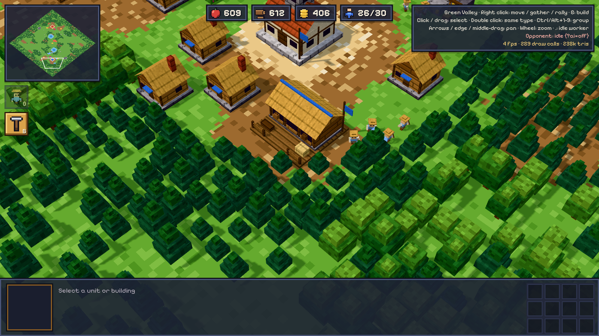
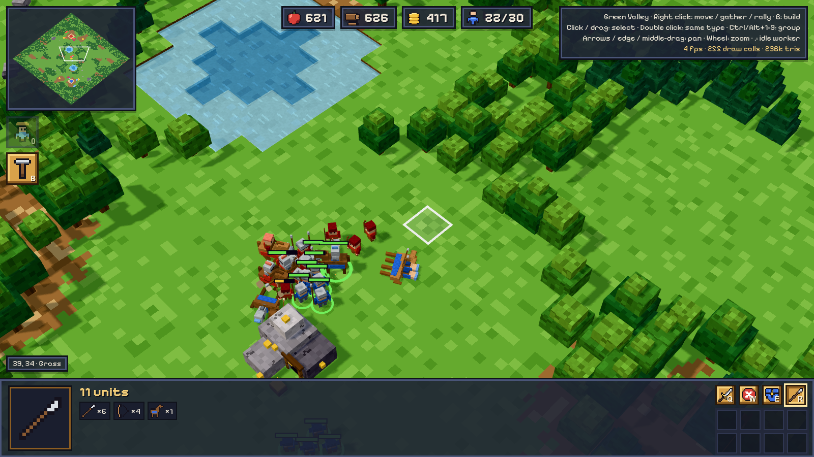
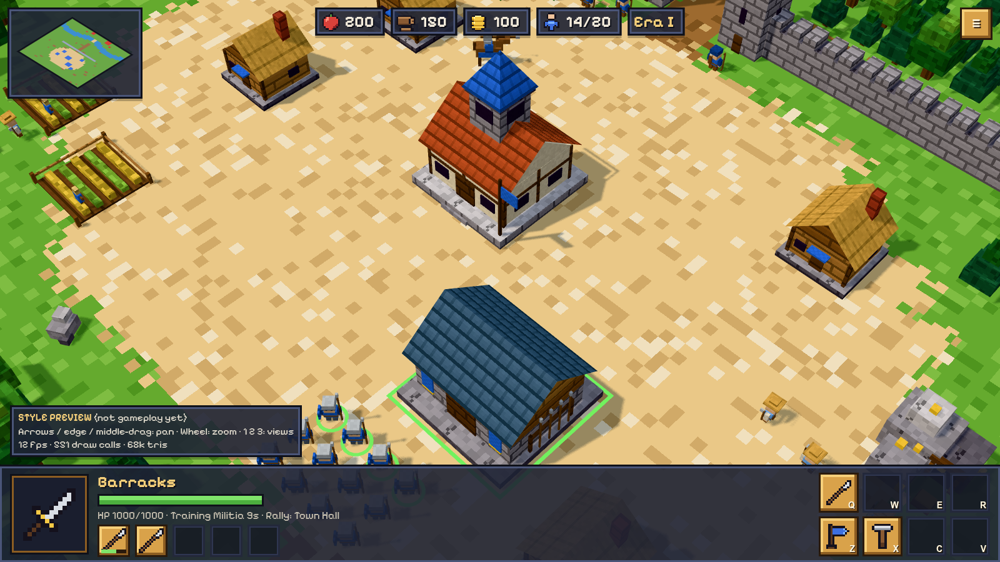

<h1 align="center">Banners of Dawn</h1>

<p align="center">
  <b>A voxel real-time strategy (RTS) game you can play right in your browser.</b><br>
  Gather resources, build a town, raise an army and crush the machine player in a 1v1 match.
</p>

<p align="center">
  <a href="https://banners-of-dawn.web.app/"><b>▶ Play now at banners-of-dawn.web.app</b></a>
</p>

<p align="center">
  <a href="https://banners-of-dawn.web.app/">
    
  </a>
</p>

<p align="center">
  
  
</p>

## About the game

Banners of Dawn is a classic-style **real-time strategy game** with a 3D voxel look (low-poly models with pixel
textures). You play a 1v1 match against a local machine player, with no install, no account and no server:

- **Economy**: workers gather food, wood and gold, build houses, farms and production buildings.
- **Army**: train Militia and Archers at the Barracks, Scout Riders and Knights at the Stable
  (see [docs/units.md](docs/units.md)).
- **Battle**: box-select, control groups, rally points, and siege the enemy Town Hall to win.
- **Opponent**: a rule-based machine player (Easy, Normal or Idle) that runs fully in your browser.
- **Maps**: Green Valley, Twin Rivers and Forest Pass, each validated to be fair and symmetric.

The full design is in [PLAN.md](PLAN.md).

## Play online

| Link                                                                        | What it opens                                                         |
| --------------------------------------------------------------------------- | --------------------------------------------------------------------- |
| [banners-of-dawn.web.app](https://banners-of-dawn.web.app/)                 | Main Menu: Play, Quick start, Settings, How to Play                   |
| [/?play](https://banners-of-dawn.web.app/?play)                             | Jump straight into a match with your last setup                       |
| [/?map=twin_rivers](https://banners-of-dawn.web.app/?map=twin_rivers)       | Play on a specific map (`green_valley`, `twin_rivers`, `forest_pass`) |
| [/?ai=normal](https://banners-of-dawn.web.app/?ai=normal)                   | Pick the opponent: `normal`, `easy` or `off`                          |
| [/?setup=scenario](https://banners-of-dawn.web.app/?setup=scenario)         | Start with a ready-made battle instead of a standard start            |
| [/?pace=blitz&speed=2](https://banners-of-dawn.web.app/?pace=blitz&speed=2) | Pace (`relaxed`, `standard`, `fast`, `blitz`) and game speed          |
| [/?army=50&enemy=20](https://banners-of-dawn.web.app/?army=50&enemy=20)     | Spawn test armies for a big fight                                     |
| [/?models](https://banners-of-dawn.web.app/?models)                         | Model viewer: every voxel model and HUD icon                          |
| [/?hud](https://banners-of-dawn.web.app/?hud)                               | HUD gallery, one section at a time (e.g. `/?hud#terrain`)             |
| [/?preview](https://banners-of-dawn.web.app/?preview)                       | Style-preview diorama (keys `1` `2` `3` switch views)                 |

Add `&art=<id>` to any link to draw it with another art collection (see below).

**Controls**: right click to move / gather / rally, click or drag to select, `B` to build, `Ctrl/Alt+1-9` for
control groups, arrows / screen edge / middle-drag to pan, wheel to zoom. `Esc` opens the pause menu (speed,
settings, restart, surrender, quit), `P` pauses and `+` / `-` change the speed.

More screenshots: [docs/preview/](docs/preview/) and [docs/milestones/](docs/milestones/).

## Art collections

All drawing data (palette, HUD icons, every voxel model) lives in [src/ui/art/collections/](src/ui/art/collections/).
The game is drawn with **Aetherfall** by default (`DEFAULT_ART_ID` in `collections/index.ts`); `?art=classic` shows
the original look. `classic/` defines everything; another collection only lists what it changes and takes the rest from
classic ([autumn.ts](src/ui/art/collections/autumn.ts) is a small example). To make one, copy `autumn.ts`, then add it to
`ART_COLLECTIONS` in `collections/index.ts`. Review it in `/?hud` (switch at the top of the sidebar, or `,` / `.`)
and play with it via `?art=<id>`.

## Setup

```bash
nvm install        # reads .nvmrc → Node 24 LTS
nvm use
npm install
npm run dev        # http://localhost:5173
```

The URL shortcuts above work locally too, e.g. `http://localhost:5173/?play`. Everything is driven by the JSON in
`src/data/` (see PLAN.md §9).

## Scripts

| Script                  | What it does                                                           |
| ----------------------- | ---------------------------------------------------------------------- |
| `npm run dev`           | Dev server with hot reload                                             |
| `npm run build`         | Typecheck, then production build into `dist/`                          |
| `npm run preview`       | Serve the production build                                             |
| `npm run typecheck`     | Type-check every module with its own `tsconfig` (engine/AI get no DOM) |
| `npm run lint`          | ESLint, including the architecture rules                               |
| `npm test`              | Vitest                                                                 |
| `npm run check`         | typecheck + lint + validate-maps + test                                |
| `npm run validate-maps` | Validate every map in `maps/` (playable, fair, symmetric)              |
| `npm run maps:generate` | Regenerate every map in `maps/` from its generator in `tools/maps/`    |
| `npm run format`        | Prettier                                                               |

## Module layout

| Folder        | Module                                                                                                                 | May import                           |
| ------------- | ---------------------------------------------------------------------------------------------------------------------- | ------------------------------------ |
| `src/shared/` | Contracts shared by everyone                                                                                           | nothing                              |
| `src/engine/` | Deterministic simulation on a square grid                                                                              | shared, data                         |
| `ai/`         | Machine player: a self-contained module (local, rule-based, in a Web Worker), no config of its own; see `ai/README.md` | shared, zod                          |
| `src/ai/`     | The app's AI settings: difficulty modes (`profiles/<mode>.json`)                                                       | shared, ai                           |
| `src/ui/`     | 3D voxel rendering (three.js), HUD, input, audio                                                                       | shared, data                         |
| `src/host/`   | Glue: game loop, wiring engine + UI + AI                                                                               | shared, engine, ai, src/ai, ui, data |
| `src/data/`   | Balance data (JSON)                                                                                                    | —                                    |
| `maps/`       | Map files (JSON)                                                                                                       | —                                    |
| `assets/`     | Audio presets / music data                                                                                             | —                                    |

These rules are enforced by `eslint.config.js`, and `tests/lint/architecture.test.ts` proves it.
The machine player and the engine **cannot use any network API**: no external AI, no third-party
services (PLAN §6.2). The page's Content Security Policy also limits connections to its own origin.
